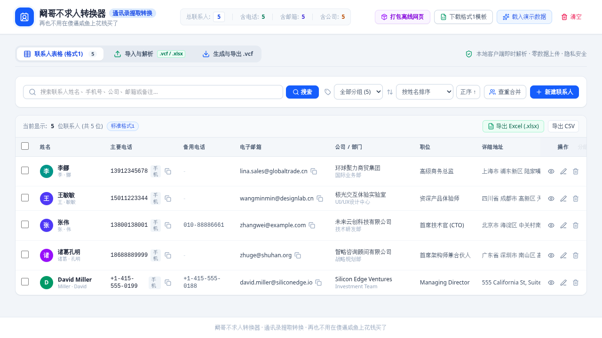
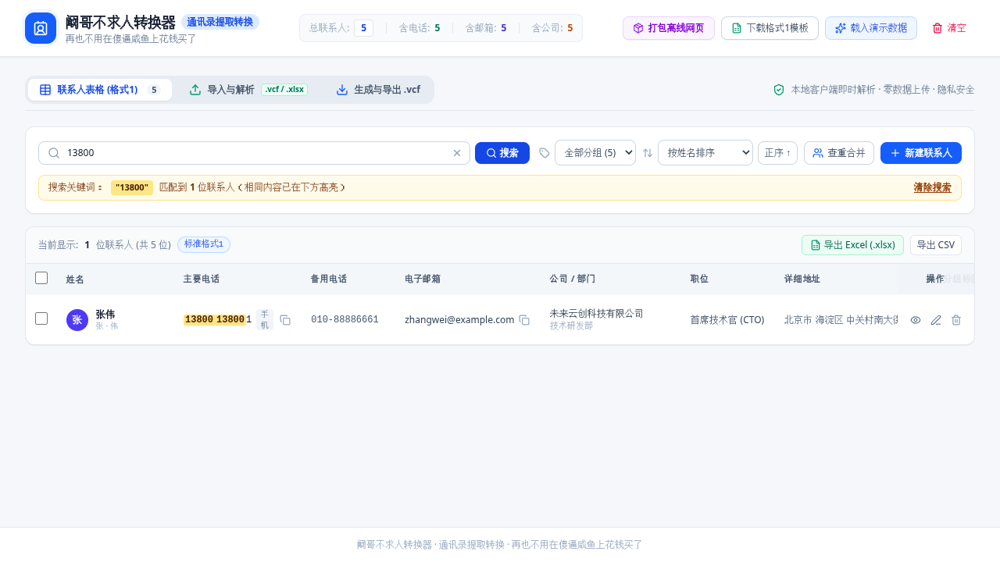

# 阚哥不求人转换器 使用说明

**VCF Contacts Hub** · 用户使用教程

> 草稿：本说明根据 `main` 分支（提交 `ed6f36b`）的源码编写。标有 `【截图：…】` 的地方待补充截图。

本工具可以把手机导出的 `.vcf` 通讯录转成 Excel/CSV 表格，也可以把表格转回 `.vcf` 导入手机。**所有操作都在你的浏览器里完成，联系人数据不会上传到任何服务器。**

---

## 0. 界面总览

页面顶部是工具栏，下面有三个标签页：

- **联系人表格 (格式1)**：查看、搜索、编辑当前所有联系人
- **导入与解析**：上传 `.vcf` 或 Excel/CSV 文件
- **生成与导出 .vcf**：设置参数并下载 `.vcf`

顶部右侧按钮：**打包离线网页**、**下载格式1模板**、**载入演示数据**、**清空**（有联系人时才显示）。中间显示总联系人数、含电话/邮箱/公司的人数（宽屏才显示）。

> 第一次打开时，表格里会自动放入 5 条**演示联系人**（张伟、李娜等），方便体验。正式使用前可以点「清空」，或直接用「覆盖现有数据」模式导入自己的文件。

你的数据会自动保存在当前浏览器里，关掉网页再打开还在。

---

## 1. VCF 转表格

1. 点击标签页 **导入与解析**。
2. 在右上角选择导入模式：
   - **覆盖现有数据**（默认）：导入后替换掉表格里现有的全部联系人；
   - **追加合并到现有**：把新联系人加到现有联系人后面。
   【截图：导入页顶部的“覆盖现有数据 / 追加合并到现有”切换】
3. 在左侧 **解析 .vcf 联系人文件** 卡片中，点击虚线框选择文件，或把 `.vcf` / `.vcard` 文件拖进去。
   【截图：VCF 拖拽上传区域】
4. 解析成功后会提示“成功解析 VCF 文件「xxx」，读取到 N 位联系人”，并自动跳到 **联系人表格** 页。
5. 在表格页点击 **导出 Excel (.xlsx)** 或 **导出 CSV**，即可得到表格文件（`联系人数据_格式1.xlsx` / `联系人数据_格式1.csv`）。
   【截图：表格页右上角的“导出 Excel / 导出 CSV”按钮】

**没有文件，只有 vCard 文本？** 点击卡片下方的 **粘贴 vCard 源码解析**，把 `BEGIN:VCARD … END:VCARD` 内容粘贴进去，再点 **解析并导入文本内容**。点 **填入测试 vCard 代码** 可以先用示例试一下。
【截图：粘贴 vCard 源码的文本框】

---

## 2. 表格转 VCF

1. （推荐）先点顶部 **下载格式1模板**，得到 `联系人信息标准表格_格式1.xlsx`。模板里有 20 个标准列和 5 行示例数据，把示例行替换成你的联系人即可。
2. 点击标签页 **导入与解析**，选择导入模式（同上）。
3. 在右侧 **导入表格（格式1）生成 .vcf** 卡片中，点击或拖入 `.xlsx` / `.csv` 文件。
   【截图：表格拖拽上传区域】
4. 导入成功后自动跳到联系人表格页，检查一下数据是否正确。
5. 点击标签页 **生成与导出 .vcf**，按「第 5 节 导出」的说明下载 `.vcf` 文件。

**表格要求：**
- 第一行必须是列名（表头），从第二行起每行一个联系人；
- 只读取**第一个工作表**；
- 至少要有姓名、电话、邮箱、公司中的一项，否则这一行会被忽略；
- 列名不一定要和模板完全一致，常见写法都能识别，比如“手机号”“电话”“mobile”都会当作主要电话（详见文末 FAQ）。

---

## 3. 查看与编辑联系人

### 查看
在 **联系人表格** 页点击任意一行，右侧会弹出详情面板，显示电话、邮箱、地址、分组标签、生日、网址、备注。电话和邮箱旁边有复制按钮。点 **查看 vCard 源码** 可以看到并复制这个联系人的 vCard 3.0 文本。
【截图：联系人详情面板】

### 编辑
点击行尾的铅笔图标，或在详情面板里点 **编辑**：
- **姓名**：填写完整姓名后，可点 **根据全名自动拆分姓/名**（支持“欧阳”“诸葛”等常见复姓，英文名按空格拆分）；
- **电话**：可添加多个，每个可选类型：手机 / 工作 / 住宅 / 主要 / 其他；
- **邮箱**：可添加多个，类型：工作 / 个人 / 其他；
- **公司与职业**、**地址**（街道、城市、省份/地区、邮编、国家）、**分组标签**（输入后按回车或点“添加”）、**生日**（日期选择器）、**网址**、**备注**。

改完点 **保存联系人**。姓名和电话至少要填一项。按键盘 `Esc` 或点面板外部可关闭（未保存的修改会丢失）。
【截图：编辑联系人表单】

### 新建
点表格页工具栏的 **新建联系人**，填写后保存，新联系人会出现在列表中。

### 删除
- 单个删除：点行尾的垃圾桶图标（**立即删除，没有确认**）；或在详情面板点删除图标，再点“删除”确认。
- 批量删除：勾选多行后，在上方出现的操作栏点 **批量删除** → **确认删除**。
- 全部清空：点顶部 **清空** → **确认清空**（无法撤销）。

### 搜索、筛选、排序
- 在搜索框输入关键词，**按回车或点「搜索」** 才会生效。可以搜姓名、电话、邮箱、公司/部门/职位、备注、分组标签、地址。
- 搜电话时会忽略空格和横线，比如搜 `138-0013` 也能找到 `13800138001`，匹配的部分会高亮。
  
- 点 **清除搜索** 恢复全部显示。
- 有分组标签时，可用“全部分组”下拉框按标签筛选。
- 排序可选按姓名 / 主要电话 / 公司名称，点“正序 ↑ / 倒序 ↓”切换方向。

---

## 4. 查重合并（去重）

1. 在 **联系人表格** 页点 **查重合并**。
2. 弹窗会列出所有疑似重复的分组，并标明原因：
   - **电话一致**：两个联系人有一个电话号码，去掉空格、横线、括号、`+` 等非数字字符后完全相同（至少 7 位数字）；
   - **姓名一致**：完整姓名完全相同（忽略首尾空格和英文大小写）。
   【截图：查重合并弹窗，显示重复分组】
3. 确认无误后点 **一键合并全部重复项**。每组合并成一条：
   - 以组里**第一条**为准；
   - 电话、邮箱合并去重，分组标签取并集；
   - 不同的备注用“；”拼接；
   - 公司、部门、职位、地址、生日、网址如果第一条是空的，就从其他条目补上。
4. 如果没有重复，会提示“未检测到重复的联系人”。

> 注意：合并是**全部一起合并**，不能只合并其中某几组；合并后无法撤销。建议合并前先导出一份 Excel 备份。

---

## 5. 导出

### 导出 .vcf
1. 点击标签页 **生成与导出 .vcf**。
2. **导出范围**：全部联系人，或 **已选中的联系人**（需要先在表格页勾选）。
   > 在表格页勾选后点“导出选中为 .vcf”只会跳到这个页面，**还需要手动点一下「已选中的联系人」**。
3. **导出文件名**：默认 `contacts_export_年月日.vcf`，可以修改。
4. **vCard 版本**：
   - **3.0**（默认，通用推荐）：适合 iPhone、安卓、Outlook、Google 通讯录等；
   - **2.1**（传统设备）：适合老式功能机、车载蓝牙或老版本安卓；选 2.1 后还能选编码：**UTF-8 纯文本** 或 **Quoted-Printable**（老设备中文乱码时可以试试后者）；
   - **4.0**：最新标准格式。
5. 右侧会实时显示生成的 vCard 源码，可点 **复制源码**；点 **下载 .vcf** 或顶部的 **立即下载 .vcf 文件** 保存。
   【截图：导出页的参数设置和源码预览】
6. 把 `.vcf` 文件通过微信、邮件等方式发到手机，用手机打开即可导入通讯录。

### 导出表格
- 表格页右上角：**导出 Excel (.xlsx)** / **导出 CSV**（导出全部联系人）；
- 导出页“导出为格式1表格文件”区域：**Excel (.xlsx)** / **CSV 格式**（按当前选择的导出范围）。

CSV 文件是 UTF-8 编码并带 BOM，用 Excel 直接打开中文不会乱码。

---

## 6. 离线版使用

不想联网、或者想发给别人用，可以下载离线版：

1. 点顶部 **打包离线网页**。
2. 在弹窗中点 **立即下载 (阚哥不求人转换器_离线版.html)**。
   【截图：打包下载离线网页版弹窗】
3. 得到一个 `.html` 文件，双击用浏览器打开就能使用，功能和在线版一样，不需要网络、不需要安装任何软件。

> 离线版的数据同样保存在浏览器本地。不同浏览器、或者文件放在不同位置时，保存的数据可能互不相通。

---

## 常见问题 FAQ

**Q：导入 .vcf 后中文是乱码？**
A：工具按 UTF-8 读取 `.vcf` 文件。如果文件中的中文是 `=E5=BC=A0` 这种 Quoted-Printable 写法，会自动解码（声明了 GB 字符集的按 GBK 解码）。但如果整个文件是用 GBK/GB2312 保存的普通文本，会出现乱码，需要先用文本编辑器另存为 UTF-8 再导入。

**Q：导入后显示“未能从该文件中解析出有效的 vCard 联系人”？**
A：文件里需要有 `BEGIN:VCARD` 和 `END:VCARD`。另外，姓名、电话、邮箱、公司都为空的卡片会被跳过。

**Q：表格的列名必须和模板一模一样吗？**
A：不必。列名不区分大小写，会忽略空格、下划线、横线、斜杠和括号，并识别常用写法。例如：
- 姓名：姓名 / 联系人 / 名称 / name
- 主要电话：主要电话 / 手机 / 手机号 / 电话 / 移动电话 / phone / mobile / tel
- 备用电话：备用电话 / 电话2 / 座机 / 工作电话 / phone2
- 邮箱：电子邮箱 / 邮箱 / email / mail
- 公司：公司/组织 / 公司 / 单位 / 企业 / company
- 备注：备注信息 / 备注 / 说明 / note / remark
- 分组：分组标签 / 分组 / 标签 / 群组 / tags / group

无法识别的列会被忽略。

**Q：一个人有好几个电话、好几个邮箱，表格里怎么写？**
A：“备用电话”和“电子邮箱”一格里可以写多个，用逗号或分号（中英文都行）分隔。“分组标签”也一样。

**Q：为什么导出的表格里少了电话？**
A：表格只有“主要电话”和“备用电话”两列，导出时只写入前两个电话，第三个及以后的电话不会出现在表格中。需要保留全部电话时请导出 `.vcf`。

**Q：电话类型在表格里怎么填？**
A：“电话类型1”：含“工”字为工作，含“家”或“宅”为住宅，其他都算手机。“电话类型2”：含“家”或“宅”为住宅，其他都算工作。

**Q：查重是按什么判断的？会不会误合并？**
A：只要两个联系人有一个电话号码的数字部分完全相同（至少 7 位），或者完整姓名完全相同，就会被列为重复。同名不同人也会被列出来，请在合并前看一下弹窗里的列表。

**Q：头像能导出吗？**
A：`.vcf` 里的头像会在表格中显示，但目前不会导出到新的 `.vcf` 或表格中。

**Q：我的数据会上传吗？**
A：不会。解析、编辑、导出都在浏览器本地完成，数据只保存在浏览器的本地存储中。清除浏览器数据会把它删掉，重要数据请及时导出备份。
